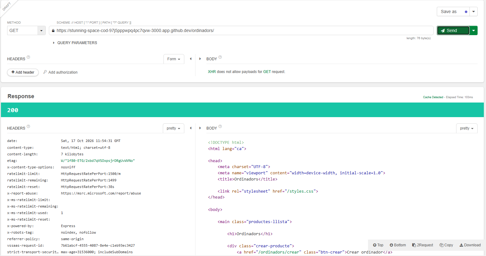
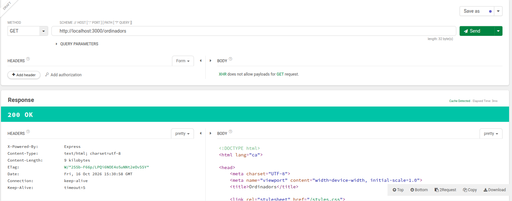
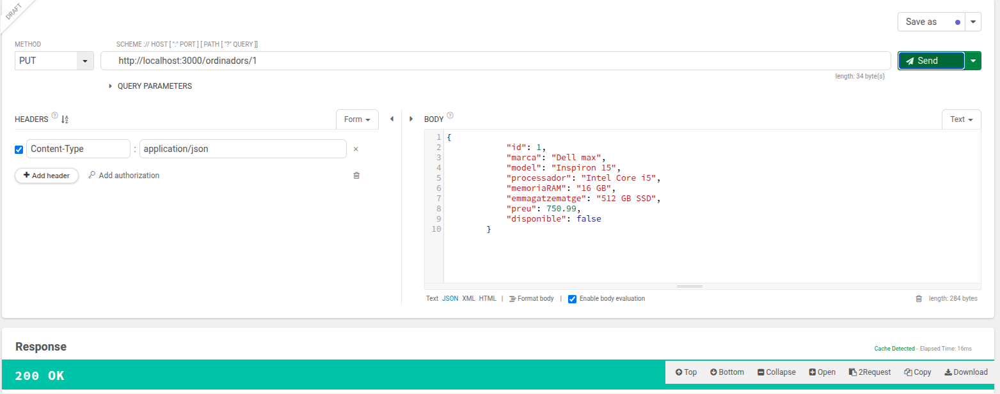
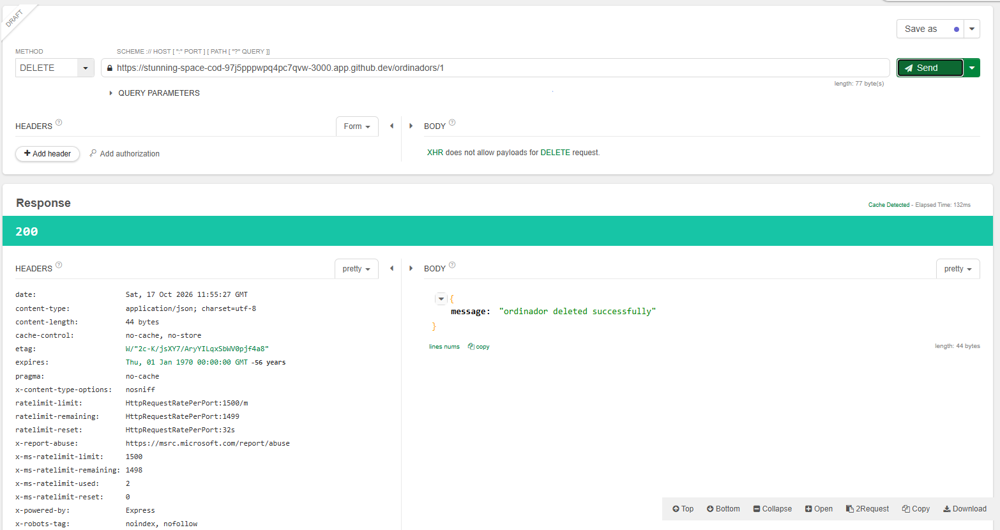

# Descripció del projecte

Aquest projecte consisteix en el desenvolupament d'una aplicació web amb **Node.js** i **Express** centrada en la gestió d'un **CRUD (Create, Read, Update, Delete)** de productes, concretament orientat a **ordinadors** i **mòbils**.

Per poder entrar, l'aplicació requereix obligatòriament un procés d'**autenticació** mitjançant credencials d'usuari. Un cop autenticat, l'usuari pot gestionar el catàleg de productes, realitzant operacions de creació, consulta, modificació i eliminació de dispositius.

L'aplicació integra diferents tecnologies:

- **Node.js** com a entorn d'execució del servidor.
- **Express** per a la gestió de rutes i la lògica de l'aplicació.
- **EJS (Embedded JavaScript Templates)** per a la generació dinàmica de les vistes.
- **JWT (JSON Web Tokens)** per implementar un sistema d'autenticació segur.
- **API REST** per gestionar les operacions CRUD sobre els productes.

L'objectiu principal és desenvolupar una aplicació funcional, segura i estructurada seguint l'arquitectura client-servidor, aplicant bones pràctiques de desenvolupament web i gestió d'usuaris autenticats.

---

# Estructura del projecte

```text
PO1_crud_awt/
│
├── db/
│ ├── db.json
│ └── User.json
│
├── node_modules/
|
├── public/
│ ├── js/
│ │ └── register.js
│ └── styles.css
│
├── routes/
│ ├── mobils.js
│ └── ordinadors.js
│
├── views/
│ ├── crear_mobils.ejs
│ ├── crear_ordinadors.ejs
│ ├── edit_mobils.ejs
│ ├── edit_ordinadors.ejs
│ ├── login.ejs
│ ├── mobils.ejs
│ ├── ordinadors.ejs
│ ├── protected.ejs
│ └── register.ejs
│
├── .env
├── .gitignore
├── config.js
├── package.json
├── package-lock.json
├── server.js
└── user-repository.js
```

---
# EndPoints

## 🔐 Autenticació (`/auth`)

| Mètode | Ruta | Descripció |
| :--- | :--- | :--- |
| `GET` | `/auth` | Mostra la pàgina de login i registre |
| `POST` | `/auth/register` | Registra un usuari nou i crea el token de sessió |
| `POST` | `/auth/login` | Inicia sessió amb usuari i contrasenya |
| `GET` | `/auth/protected` | Pàgina protegida que només es mostra si l'usuari està autenticat |
| `POST` | `/auth/logout` | Tanca la sessió de l'usuari i esborra la cookie |

---
## 📱 Mòbils (`/mobils`)

| Mètode | Ruta | Descripció |
| :--- | :--- | :--- |
| `GET` | `/mobils` | Mostra la vista amb tots els mòbils |
| `GET` | `/mobils/crear`  | Mostra el formulari per crear un mòbil |
| `GET` | `/mobils/:id/edit` | Carrega el formulari d'edició d'un mòbil concret |
| `POST` | `/mobils` | Crea un nou mòbil i redirigeix |
| `PUT` / `POST` | `/mobils/:id` | Actualitza un mòbil existent |
| `DELETE` | `/mobils/:id` | Elimina un mòbil |

---

## 💻 Ordinadors (`/ordinadors`)

| Mètode | Ruta | Descripció |
| :--- | :--- | :--- |
| `GET` | `/ordinadors` | Mostra la vista amb tots els ordinadors |
| `GET` | `/ordinadors/crear`  | Mostra el formulari per crear un ordinador |
| `GET` | `/ordinadors/:id/edit` | Carrega el formulari d'edició d'un ordinador concret |
| `POST` | `/ordinadors` | Crea un nou ordinador i redirigeix |
| `PUT` / `POST` | `/ordinadors/:id` | Actualitza un ordinador existent |
| `DELETE` | `/ordinadors/:id` | Elimina un ordinador |

---

# Captures del CRUD


# Consultar productes

Tots els productes es mostren en una llista dinàmica generada amb EJS.

Es mostren 2 tipus de productes, **ordinadors** i **mòbils**.

Depenent de la secció (ordinadors/mòbils), es mostren els productes propis.

## Captura de pantalla de la tots els productes de la secció


---

# Crear un producte

L'aplicació permet afegir nous dispositius mitjançant un formulari.

Les dades principals són:

- Marca
- Model
- Processador
- Memòria RAM
- Emmagatzematge
- Preu
- Disponibilitat

## Captura de pantalla del formulari de creació



---

## Editar un producte

L'usuari pot modificar la informació dels dispositius existents.

Mitjançant el botó **Editar** s'accedeix a un formulari amb les dades actuals del producte.

Les modificacions es processen mitjançant una petició **PUT**.

## Captura de pantalla de l'edició



---

# Eliminar un producte

Els productes també es poden eliminar de la base de dades.

Aquesta operació utilitza una petició **DELETE** de l'API REST.

## Captura de pantalla de l'eliminació


